 

---

### &nbsp;SPREAD · THE WORKBENCH&nbsp;
*things i've built, shipped, and occasionally rebuilt.*

**[see everything I'm building → the full workbench](https://yashtyagi.xyz)**

---

---

### &nbsp;SPREAD · THE STACK&nbsp;
*the tools on the desk right now.*

---

### &nbsp;SPREAD · THE MARGINALIA&nbsp;
*a few numbers from the GitHub side of the notebook.*

<picture>
  <source media="(prefers-color-scheme: dark)" srcset="https://github-readme-stats.vercel.app/api?username=YashTygi&show_icons=true&hide_border=true&count_private=true&include_all_commits=true&bg_color=1e1a16&title_color=c67164&text_color=e8e4dd&icon_color=80624d">
  
</picture>
<picture>
  <source media="(prefers-color-scheme: dark)" srcset="https://github-readme-stats.vercel.app/api/top-langs?username=YashTygi&layout=compact&hide_border=true&bg_color=1e1a16&title_color=c67164&text_color=e8e4dd">
  
</picture>

---

